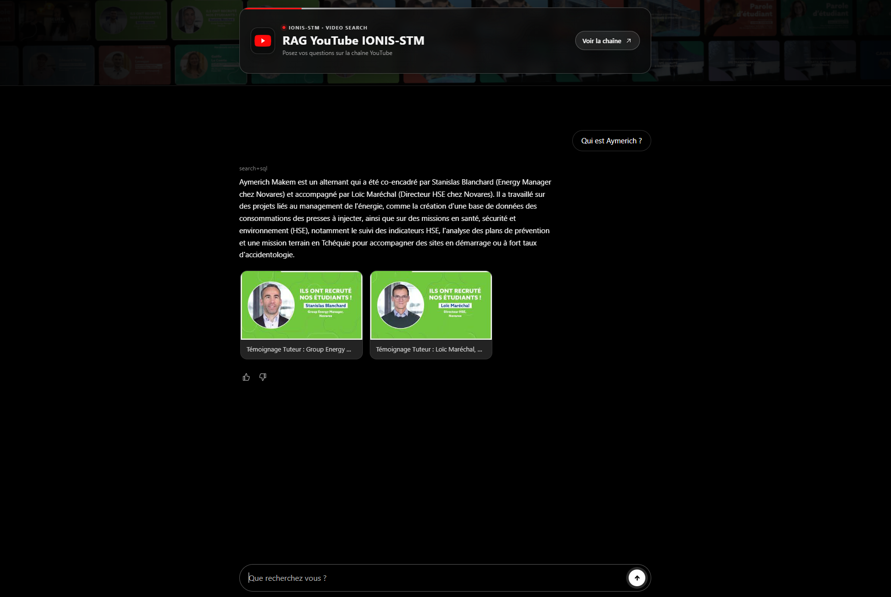
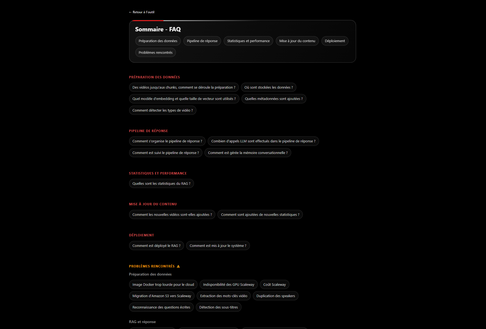
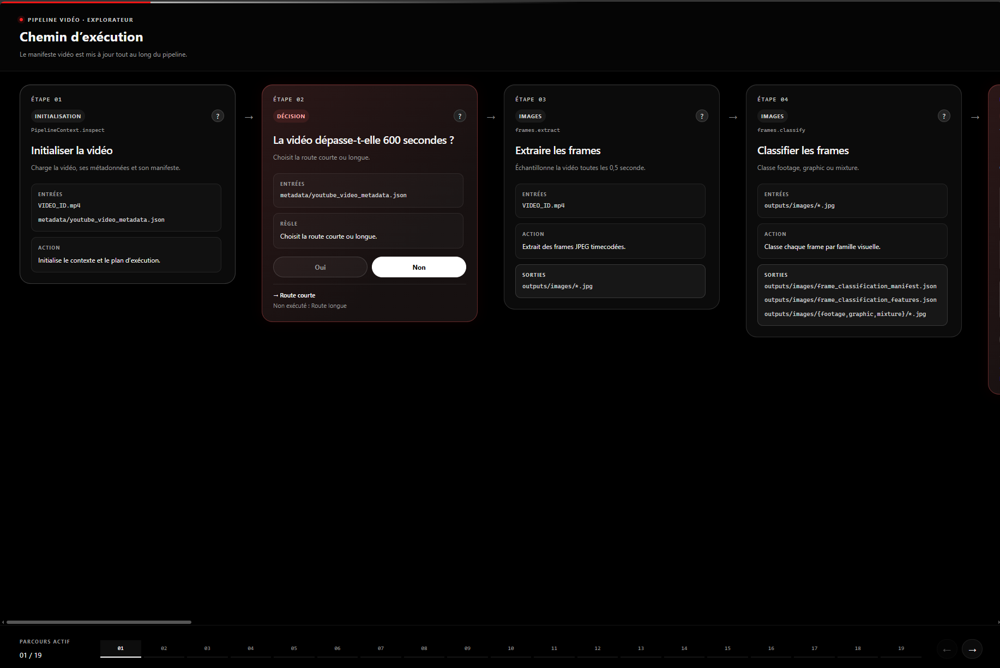
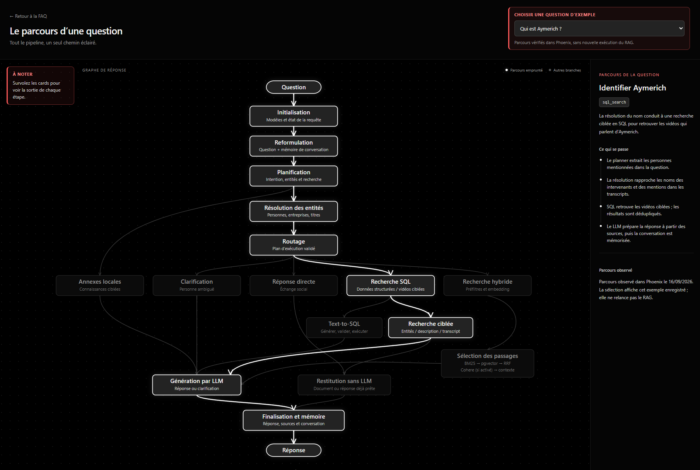

# RAG YouTube IONIS-STM

Ce projet transforme les vidéos de la chaîne YouTube IONIS-STM en une base interrogeable : un pipeline prépare les vidéos, leurs transcriptions, leurs métadonnées et leurs embeddings, puis un RAG répond aux questions en s'appuyant sur les contenus retrouvés. L'application est disponible sur [ionis.tanguym.fr](https://ionis.tanguym.fr) ; son fonctionnement, son architecture, ses performances et son déploiement sont détaillés dans la [FAQ](https://ionis.tanguym.fr/faq). Explorez aussi le [pipeline de préparation des vidéos](https://ionis.tanguym.fr/pipeline_preparation_videos/) et le [pipeline de réponse](https://ionis.tanguym.fr/pipeline_reponse/).

## Aperçu

### Application

[](https://ionis.tanguym.fr)

### FAQ

[](https://ionis.tanguym.fr/faq)

### Pipeline de préparation des vidéos

[](https://ionis.tanguym.fr/pipeline_preparation_videos/)

### Pipeline de réponse

[](https://ionis.tanguym.fr/pipeline_reponse/)

## Installation locale

Les dépendances sont gérées par [uv](https://docs.astral.sh/uv/) : `pyproject.toml` déclare un groupe par rôle (`api`, `vps`, `gpu`, `ytdlp`, `studio`) et `uv.lock` fige l'ensemble pour Windows et Linux.

```bash
uv sync --python 3.10
UV_PROJECT_ENVIRONMENT=.venv-studio-py313 uv sync --python 3.13 --no-default-groups --group studio
start_app_local.bat
```

Après une modification de `pyproject.toml`, `uv lock` met à jour le lock. L'image GPU installe encore ses couches depuis `requirements-gpu.txt` : un test vérifie que ses versions restent celles de `uv.lock`.
