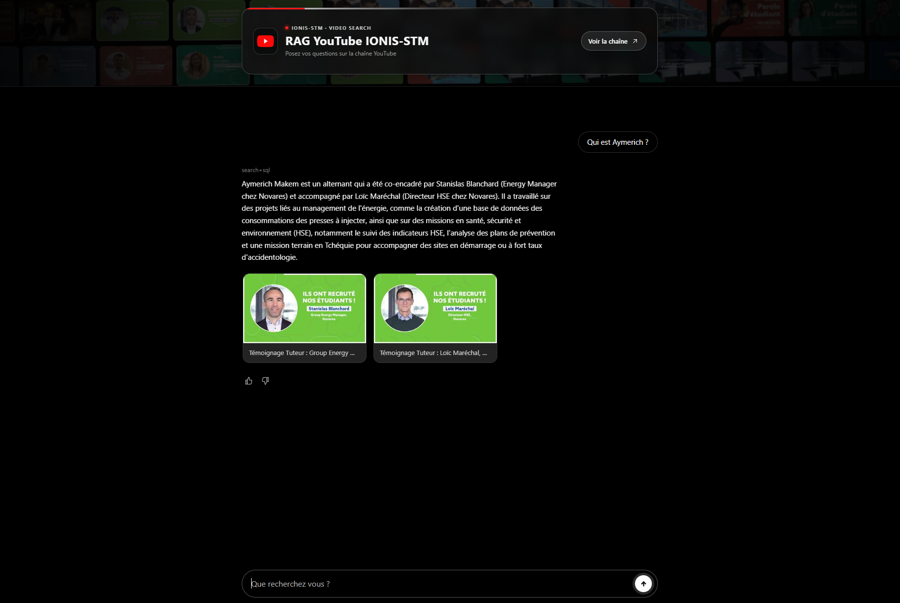
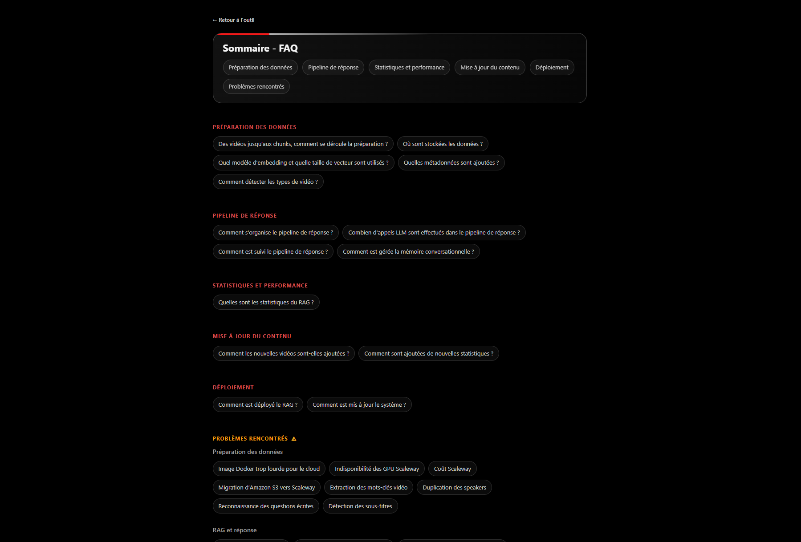
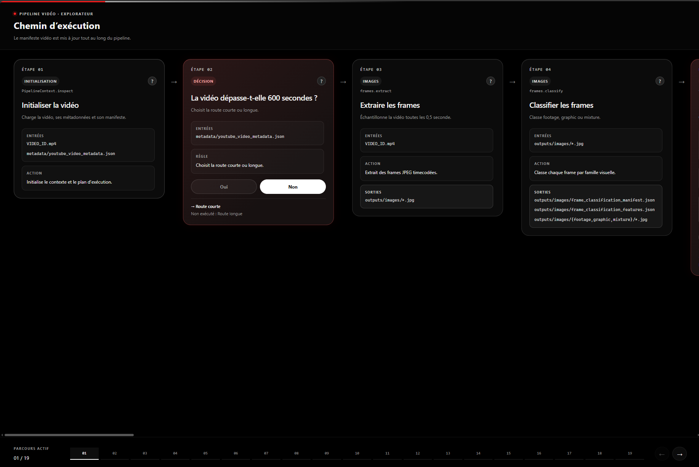
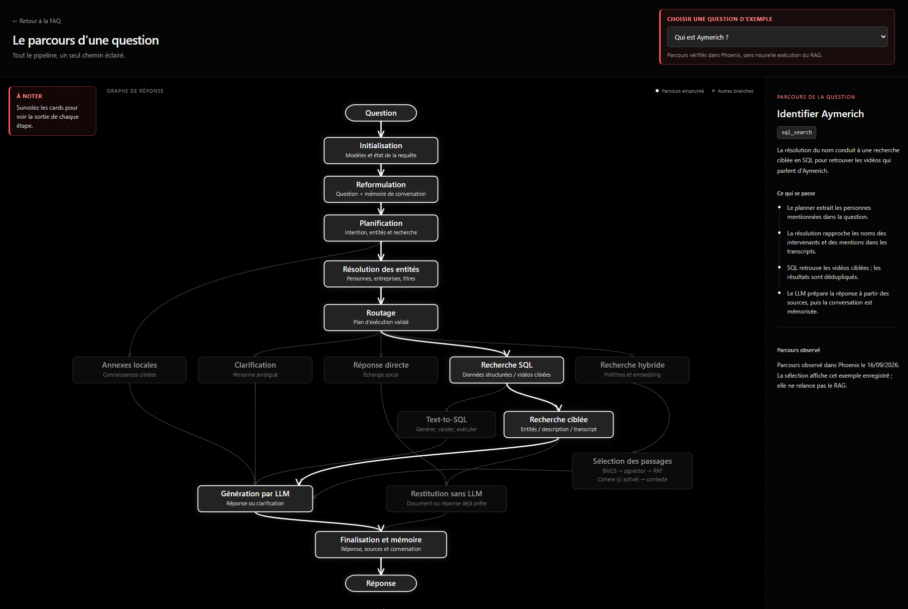

# RAG YouTube IONIS-STM

Ce projet transforme les vidéos de la chaîne YouTube IONIS-STM en une base interrogeable : un pipeline prépare les vidéos, leurs transcriptions, leurs métadonnées et leurs embeddings, puis un RAG répond aux questions en s'appuyant sur les contenus retrouvés. L'application est disponible sur [ionis.tanguym.fr](https://ionis.tanguym.fr) ; son fonctionnement, son architecture, ses performances et son déploiement sont détaillés dans la [FAQ](https://ionis.tanguym.fr/faq). Explorez aussi le [pipeline de préparation des vidéos](https://ionis.tanguym.fr/pipeline_preparation_videos/) et le [pipeline de réponse](https://ionis.tanguym.fr/pipeline_reponse/).

## Aperçu

### Application

[](https://ionis.tanguym.fr)

### FAQ

[](https://ionis.tanguym.fr/faq)

### Pipeline de préparation des vidéos

[](https://ionis.tanguym.fr/pipeline_preparation_videos/)

### Pipeline de réponse

[](https://ionis.tanguym.fr/pipeline_reponse/)

## Exploitation et observabilité

[](https://tangmomb.github.io/status/)
[](https://tangmomb.github.io/status/)

Le RAG tourne sur un VPS Contabo et se surveille sur trois niveaux, avec des alertes par e-mail :

- **Disponibilité et serveur** : [page de statut publique](https://tangmomb.github.io/status/) alimentée toutes les 5 minutes depuis l'extérieur (Upptime), ressources du serveur dans Beszel, alerte à chaque échec de sauvegarde ou de mise à jour.
- **Qualité des réponses** : chaque matin, 10 questions de référence passent par tout le pipeline, puis un LLM juge (mistral-large, distinct du modèle qui répond) note la fidélité aux sources et la pertinence de ces réponses et du trafic de la veille ; les notes sont des annotations Phoenix. Le recall du golden dataset est remesuré en production deux fois par mois.
- **Robustesse** : limites par IP et budget quotidien sur les routes payantes, logs JSON avec `request_id`, test hebdomadaire de restauration de la sauvegarde dans une base jetable.

Objectifs de service (SLO), carte des contrôles et runbook : [docs/exploitation.md](docs/exploitation.md).

## Installation locale

Les dépendances sont gérées par [uv](https://docs.astral.sh/uv/) : `pyproject.toml` déclare un groupe par rôle (`api`, `vps`, `gpu`, `ytdlp`, `studio`) et `uv.lock` fige l'ensemble pour Windows et Linux.

```bash
uv sync --python 3.10
UV_PROJECT_ENVIRONMENT=.venv-studio-py313 uv sync --python 3.13 --no-default-groups --group studio
start_app_local.bat
```

Après une modification de `pyproject.toml`, `uv lock` met à jour le lock. L'image GPU de Modal (`deploy/modal_app.py`) installe ses couches depuis `requirements-gpu.txt` et ses propres versions épinglées : `tests/test_gpu_image.py` vérifie qu'elles restent celles de `uv.lock`.
